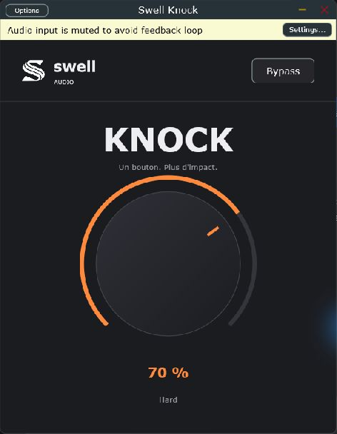

# Swell Knock — 0.1.0 prototype



*Capture réelle de la version Standalone Windows. L’entrée audio est coupée par défaut pour éviter le larsen.*

Dépôt du projet : https://github.com/sevYOnDaTracks/Swell-Knock

Un bouton : attaque, corps et saturation progressive pour les kicks.
Fabricant : Swell-audio. Logo officiel inclus.

## Utilisation

Insérer sur la piste du kick, puis monter Knock. Double-clic : retour à zéro.
Le bypass conserve la latence déclarée au DAW. Le paramètre Knock et le bypass
sont automatisables et sauvegardés avec le projet. Mono et stéréo pris en charge.
La compensation de gain est une courbe fixe, pas une normalisation automatique
du volume perçu : comparer à l'oreille à volume similaire.

Le moteur utilise une détection de transitoires liée en stéréo, un renfort du corps
et une saturation douce suréchantillonnée 4 fois. Version de travail à valider
sur plusieurs kicks avant distribution. Ce n'est pas un limiteur de sécurité.

## Windows

Copier le dossier complet `Swell Knock.vst3` dans
`C:\Program Files\Common Files\VST3`, puis relancer le scan du DAW.
L'application `Swell Knock.exe` fonctionne sans DAW. Ses réglages Audio/MIDI
permettent de choisir l'interface audio et l'entrée à traiter.
Le Standalone traite une entrée audio, il n'intègre pas de lecteur de samples.

## Compilation

JUCE 8.0.6 est téléchargé par CMake. Windows : Visual Studio 2022 C++ et CMake.

```powershell
cmake -S . -B build -G "Visual Studio 17 2022" -A x64
cmake --build build --config Release --parallel 3
ctest --test-dir build -C Release --output-on-failure
```

Mac : Xcode et CMake ; formats VST3, AU et Standalone, Intel et Apple Silicon.

```sh
cmake -S . -B build -DCMAKE_BUILD_TYPE=Release '-DCMAKE_OSX_ARCHITECTURES=arm64;x86_64' -DCMAKE_OSX_DEPLOYMENT_TARGET=11.0
cmake --build build --parallel 3
ctest --test-dir build --output-on-failure
```

Les sorties sont dans `build/SwellKnock_artefacts/Release/`.
Le workflow GitHub Actions fourni compile Windows et macOS lorsqu'il est exécuté
dans un dépôt GitHub. La présence du workflow ne signifie pas qu'il a été exécuté.
Les binaires ne sont pas signés. VST2 n'est pas configuré : il nécessite un SDK
VST2 et les droits correspondants. Ce projet livre le format VST3.

JUCE est une dépendance sous AGPLv3 ou licence commerciale ; choisir la licence
adaptée avant distribution. Voir `build/_deps/juce-src/LICENSE.md`.

## Démonstration audio reproductible

`Tools/RenderDemo.cpp` charge le VST3 compilé, génère un kick original, traite
la boucle à 70 %, compense la latence puis égalise le RMS des versions avant/après.
Il ne remplace pas le traitement par une simulation.
Construire l'outil avec `-DKNOCK_BUILD_DEMO=ON`, puis la cible `KnockDemo`.
L'exécutable prend le chemin absolu du VST3 et le dossier de sortie en arguments.
La comparaison contient quatre passages de quatre secondes : avant, après,
avant, après, à 120 BPM. Les WAV sont en 48 kHz / 24 bits.
